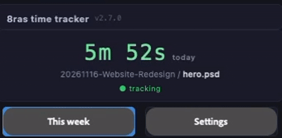
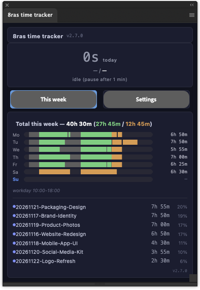
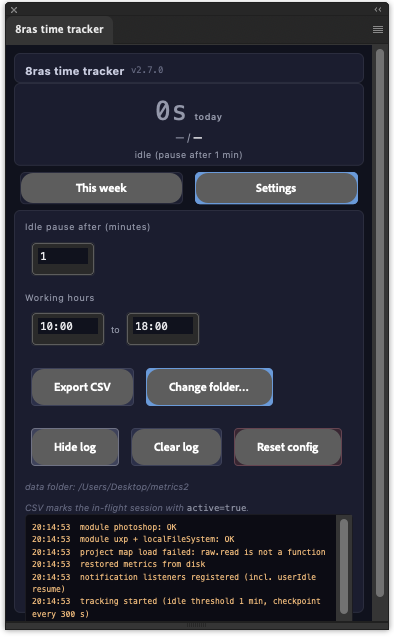

# 8ras Time Tracker

A lightweight, offline Adobe Photoshop UXP plugin that tracks active working time per project and file, stores all data locally in a single `metrics.json`, and provides a dockable panel with a live timer, weekly dashboard, settings, and CSV export.

## Features

- **Live timer** for the active document -- shows the total tracked time TODAY for that file (committed sessions plus the in-flight one), so it never resets on idle pauses or checkpoints. Automatically resumes after idle: the panel polls `historyStates` for any undoable step (brush strokes included) and also listens to Photoshop's own `userIdle` event, so the session reopens on any user input, without needing to switch tools or documents.
- **Automatic project grouping** by parent folder name, plus "Unsaved Documents" for unsaved canvases.
- **Idle detection** with a configurable threshold (default: 2 minutes). Sessions are committed when no activity is detected within the threshold period.
- **Instant commit on document switch** -- switching tabs or documents immediately commits the previous session.
- **Real-time positioned timeline** (v2.7.0+): The weekly dashboard shows a time-based track for each day. The track spans from 30 minutes before your workday start to 4 hours after your workday end. A grey band marks the workday window. Green bars show work performed inside the workday, orange bars show work performed outside it (including weekends). Bars are positioned at their actual time of day, not stacked left-to-right. Sessions that cross workday boundaries are split into in/out parts.
- **Working hours** (configurable in Settings, default 10:00-18:00): defines the workday window used by the real-time timeline. Green time falls inside the workday, orange time falls outside it, and Saturday/Sunday always render fully orange.
- **Custom tooltips** (v2.7.0+): Hovering over any day's bar row shows a tooltip with the day's total regular hours (green) and extra hours (orange), e.g. "regular: 8h 15m / extra: 1h 30m". UXP doesn't support native `title` tooltips, so these are implemented with a floating div.
- **Weekly dashboard** ("This week" tab, toggles the whole view on/off): Monday-to-Sunday rows (Mo through Su), real-time positioned bars per day, "Total this week -- X / Y" header (hours inside / outside the workday), per-project breakdown.
- **Explicit time units**: the live timer shows "1h 05m 09s" (hours, minutes, seconds). Dashboard totals use "1h 05m" / "4m" / "0m" (hours + minutes only, no seconds).
- **CSV export**: one row per session, UTF-8 BOM included for Excel compatibility. Format: `date,project,file,session_start,session_end,seconds,active`.
- **5-minute checkpoints**: intermediate saves every 5 minutes so no work is lost if Photoshop crashes or closes unexpectedly.
- **Persistent token**: the selected data folder is remembered between Photoshop sessions using UXP's persistent token mechanism.
- **Settings panel**: adjust idle threshold and working hours (start/end time), reconfigure the data folder ("Change folder..."), toggle internal log, export CSV, and reset configuration.
- **Fully offline**: no network calls, no build step, no dependencies.

## Screenshots

### Live Tracking
<p align="center"></p>

<p align="center">
  
  
</p>

## Installation

1. Install Photoshop 23.0.0 or later along with UDT (UXP Developer Tools).
2. In UDT, select **Add Project** and point it to this repository folder.
3. In Photoshop, open **Window > 8ras Time Tracker**.
4. On first launch, use **Select folder...** (native macOS picker) to choose where tracking data will be stored.

If anything fails, the panel displays an error screen with details (or a "Show log" button inside Settings). There are no silent failures: module errors, disk errors, or token errors all appear in both the panel and the UDT console with `[8ras]` prefix.

Note: this plugin uses a new manifest ID (`com.8ras.time-tracker.v2`), so Photoshop registers it as a fresh installation. The first launch always asks for the data folder even if you have used earlier versions.

## UXP API Reference (verified against AdobeDocs/uxp-photoshop)

| Purpose | API call |
|---|---|
| Folder picker | `uxp.storage.localFileSystem.getFolder()` |
| Remember folder | `createPersistentToken(entry)` / `getEntryForPersistentToken(tokenString)` |
| Read file | `folder.getEntry(name)` returns File; then `file.read()` (UTF-8 default) |
| Write file | `folder.createFile(name)` returns File; then `file.write(data[, {append}])` |
| Activity tracking | `photoshop.action.addNotificationListener(actionNames[], callback)` |

Important: UXP does not support ES modules (`<script type="module">`, dynamic `import()`) and some builds omit `uxp.storage.local`. The entire plugin is a single classic `<script>` (`main.js`) loaded from `index.html`.

## Data files (inside your chosen folder)

| File | Contents |
|---|---|
| `metrics.json` | `{ version: 1, created: ISO timestamp, projects: { projectName: { files: { fileName: { filePath, totalSeconds, sessions[] } }, totalSeconds }, totals: { days: {}, projects: {} } } }` |
| `.tracker-token.json` | Metadata marker: app name, version, folder path, threshold, working hours (minutes from midnight), persistent token string, creation date. The actual token is also stored in panel `localStorage`. |
| `8ras-tracker-YYYYMMDDHHMM.csv` | Generated on each CSV export. |

Session record: `{ id, date, startTime, endTime, seconds, project, file, filePath, isActive }`

## Project structure

```
manifest.json      ← UXP Manifest v5 (id com.8ras.time-tracker.v2, requires localFileSystem)
index.html         ← minimal shell: static banner + <script src="main.js">
main.js            ← complete plugin logic (classic script, no modules)
style.css          ← dark theme styles
assets/icon.png    ← icon shown in Photoshop's Window menu (all themes)
test/smoke.cjs     ← headless test suite (faithful mock of the real PS UXP API)
```

## Running tests

```bash
node test/smoke.cjs
```

Covers: fresh install, folder selection + persistent token, activity tracking, idle timeout, document switching, unsaved documents, CSV export, threshold persistence, full restart restore, folder reconfiguration with data preservation, and working-hours visualisation (in/out split, persistence, weekend-always-outside rule, toggle behaviour).

All 85 assertions pass across UTC, Europe/Madrid, and America/New_York timezones.

## License

Private -- personal use only.
